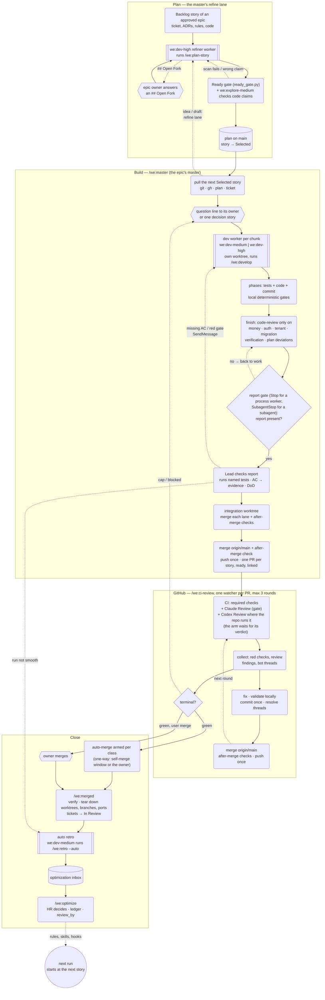

# Workflow

## The whole loop

From an epic's first story to `/we:merged`. Rounded boxes are skills, `[[…]]` agents, hexagons
human decisions, cylinders the records the loop writes. Every loop back is a dotted edge.



## Plan: epics and stories

| Unit | Artifact | Verb |
|---|---|---|
| Goal file | goals with metrics, no epics | — (you and the escalation owner) |
| Epic | one outcome, `serves: <metric>`, at `docs/plans/<epic>-epic.md` | `/we:epic` |
| Story | one PR, build-ready plan at `docs/plans/<KEY>-story.md` | `/we:plan-story` (a refiner worker) |

`/we:epic` writes or sharpens an epic and shows status by default; an epic too big for one outcome
becomes linked epics. Approval is per epic: a story plan that passes the Ready gate is Selected
without a per-story sign-off. `/we:council` convenes role lenses on any question; `/we:grill`
stress-tests any plan one question at a time. Epic frontmatter and mirror block:
[we/references/epic-plan.md](../we/references/epic-plan.md).

## Build: one master per epic, one PR per story

`/we:master` is the epic's master. It reads each story's state from git, starts a refiner worker
(`/we:plan-story`) for a story without a plan, and a dev worker (`/we:develop`) for a Selected
story. The worker implements the phases in its own worktree, runs the local gates, commits
and reports; it opens no PR and runs no CI. Local review is deterministic (hooks, the affected
tests); the only local LLM review is one `code-review` at `high` for money, auth, tenant isolation
or a migration, because CI runs the Claude and Codex reviews on the PR. The Lead checks the report,
merges the base, pushes once, opens the story's PR (`/we:pr` does the same by hand) and runs
`/we:ci-review` after CI concludes, up to three rounds.
`/we:ac-review` checks a branch against its acceptance criteria and the DoD on demand.

The dispatch contract: [we/references/worker-dispatch.md](../we/references/worker-dispatch.md).
With a crew, its `launch.worker` is the command that starts each worker
as a session of its own (§ *Worker launch backend* there); a subagent reads and reviews, never
builds. Without a crew a worker may run as a subagent, which bills the Lead's account.

## Crew

With a crew (`/we:setup` § Crew writes `.weside/crew.json`), the build above runs inside the crew
process: you approve epics; a Product Owner orders them; a coordinator starts one master per epic in
progress (a session that runs `/we:master`) and carries what goes to you through the board
(`/board`); component owners judge the HOW; a Tester accepts on staging and moves the story to Done.
Every session loads the crew process at start (`we/process/L0.md`) and its role card
(`we/roles/`). The crew file: [we/references/companion-session.md](../we/references/companion-session.md) § Crew.

### Several humans

Several people can work on one project, each running `wclaude --start` with their own crew sessions
on their own machine; the machines share only the repo, the ticketing system and chat. The crew file
names them under `humans` (schema: `we/scripts/crew.py` § Humans; `/we:setup` § Crew asks for them,
[we/skills/setup/references/humans.md](../we/skills/setup/references/humans.md)):

```json
"humans": {
  "alice": {"name": "Alice", "email": "alice@example.com", "decides": ["money", "prod"],
            "owns_states": ["selected", "in_progress", "in_review"],
            "runs": ["coordinator", "architecture", "acceptance", "masters"]},
  "bob":   {"name": "Bob", "email": "bob@example.com", "decides": ["product"],
            "owns_states": ["backlog"], "runs": ["product"],
            "companions": {"product": "Paula"}}
},
"board": {"ticketing": "jira", "jql_scope": "project = PROJ",
          "signals": [{"state": "selected", "role": "coordinator", "jql_window": "35m"}]}
```

- `wclaude --start` finds who you are (`WE_HUMAN`, else `git config user.email`) and starts the
  coordinator if you run it, else your first role; `--role <key>` starts another of your roles. Each
  session gets `WE_HUMAN`, `WE_ROLE_ID` (the role key) and `WESIDE_COMPANION` (your name for it).
- Each state has one owning human. The product role moves a story to Selected only with
  `board.py select`; that move is the coordinator's start signal, which `board.py signals` puts on
  its board.
- Across machines, a question is a ticket comment plus a label (`board.py ask --to <human>`), a
  claim a ticket comment (`board.py claim`); chat only wakes someone. Verbs: [we/docs/board.md](../we/docs/board.md) § Several humans.

## The effort rule

- The default worker is `we:dev-medium` (Opus, effort `medium`).
- `we:dev-high` for a promise that must hold across several code paths, for transactions, money or
  idempotency, for a fix routing around a fragile path, for a second attempt after a failed worker,
  and for plan-writing. The Lead names the reason in the dispatch.
- Implementation never runs on Sonnet. Haiku or Sonnet only for chunks the Lead names mechanical.
- One implementer per story. Parallel workers only for disjoint files with a contract that already
  exists on the base branch.

The measurements behind these rules: [we/AUTHORING.md](../we/AUTHORING.md), section *Measured facts
a skill must respect*.

## Watch: `/flow`

`/flow <KEY>` opens a pane that maps each story onto the loop above: Plan and Approval are the
*Plan* box, Build the dev worker, PR, CI and Review the *GitHub* box, Merge the *Close* box. It
reads git and `gh` on its own every two minutes, so it shows the same state whether the Lead, a
worker or you moved the story. Its buttons start the verb the state calls for (`/we:standup`,
`/we:master`, `/we:ci-review`, `/we:epic`). Details: [flow.md](flow.md).

## Deliver

Claude arms auto-merge once the checks and the Codex verdict are in; the computed one-way class merges through the repo's self-merge window or by you (`/we:master` § Close the run). Plan first: a code PR of a story whose plan `docs/plans/<KEY>-story.md` is not on `origin/main` yet, or whose story is still On Hold or Backlog on the board, is never merged or armed (the merge hook; every story key the branch and title name counts), and a one-way refusal names it too, for your hand merge. `/we:merged` closes out: worktrees, branches, processes, each landed story to In Review once its PR is linked; Done follows acceptance.
